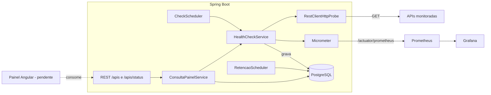

# monitoramento_api

[](https://github.com/TavinhoSilva06/monitoramento_api/actions/workflows/backend-ci.yml)

Backend em Java 21 e Spring Boot 4.1.1 que monitora APIs: faz checagens HTTP periódicas, grava o histórico no PostgreSQL, marca uma API como `DOWN` após três falhas seguidas e expõe métricas para Prometheus e Grafana.

O frontend em Angular ainda não foi iniciado; ele só começa depois que o backend estiver completo. O plano está em [projeto_painel_monitoramento_apis.md](projeto_painel_monitoramento_apis.md), o andamento detalhado em [CHECKLIST_BACKEND.md](CHECKLIST_BACKEND.md), e o procedimento de diagnóstico em [RUNBOOK.md](RUNBOOK.md).

## Arquitetura



A regra de alerta e o agendador não dependem do banco nem do Micrometer: eles falam com portas (`application/port`), e os adaptadores ficam em `infrastructure`.

## Estado atual

**Pronto**

- CRUD de APIs monitoradas (`/apis`), com validação e erros no formato `ProblemDetail` (400, 404, 409, 415).
- Checagem periódica com concorrência limitada e timeouts configuráveis.
- Histórico no PostgreSQL com índice em `(api_id, checked_at)`, e retenção diária (30 dias por padrão).
- Regra de alerta: `UP` → `DEGRADED` → `DOWN` (três falhas seguidas), com o limite configurável. Estado restaurado do histórico ao reiniciar.
- Endpoints de leitura para o painel: situação atual, histórico por período e resumo (uptime, latência média e p95). CORS liberado para `http://localhost:4200`.
- Métricas do próprio monitor no Micrometer, expostas em `/actuator/prometheus`.
- Logs estruturados em JSON (ECS) no console.
- Swagger UI em `/swagger-ui.html`.
- Dockerfile do backend e pilha completa no Docker Compose (backend, PostgreSQL, Prometheus e Grafana com dashboard provisionado).
- Testes (75): unitários, de controller, de persistência e de fluxo completo, todos com PostgreSQL real via Testcontainers. Cobertura de linhas de 95,7%, com mínimo de 85% no build.
- CI no GitHub Actions (`.github/workflows/backend-ci.yml`).

**Pendente**

- Capturas de tela do Grafana e do Swagger para este README (feitas manualmente).
- Frontend Angular (próxima etapa, depois do backend completo).

**Conhecido**

- Versões das imagens do Compose (`postgres:latest`, `prom/prometheus:latest`, `grafana/grafana:latest`) não estão fixadas. Fixar a versão evita mudanças inesperadas.
- A segurança é local: o CRUD fica aberto. Expor fora da máquina exige autenticação.

## Pré-requisitos

- JDK 21
- Docker (PostgreSQL, e a pilha completa)

## Como rodar

Há dois modos. Os dois precisam do arquivo `.env` na raiz, criado a partir do modelo:

```bash
cp .env.example .env   # e defina POSTGRES_PASSWORD
```

O `.env` não vai para o Git. O `compose.yaml` exige a variável `POSTGRES_PASSWORD`.

### Modo desenvolvimento (backend na máquina, banco no Docker)

```bash
cd backend
./mvnw spring-boot:run
```

O Spring sobe só o PostgreSQL definido em `compose.yaml` (spring-boot-docker-compose) e cria as tabelas pelo JPA (`ddl-auto=update`). A aplicação roda em `http://localhost:8080`.

### Modo completo (tudo no Docker)

```bash
docker compose --profile completo up -d --build
```

| Serviço | Endereço | Observação |
|---|---|---|
| Backend | http://localhost:8080 | API e Swagger |
| Prometheus | http://localhost:9090 | Alvo `backend:8080/actuator/prometheus` |
| Grafana | http://localhost:3000 | Usuário `admin`; senha em `GRAFANA_ADMIN_PASSWORD` (padrão `admin`) |
| PostgreSQL | porta aleatória do host | `docker compose port postgres 5432` |

O dashboard "Monitoramento de APIs" já vem provisionado no Grafana. Para parar: `docker compose --profile completo down`.

Acesse também:

- Swagger UI: `http://localhost:8080/swagger-ui.html`
- Saúde: `http://localhost:8080/actuator/health`

## Endpoints

### CRUD

| Método | Rota | Descrição | Respostas |
|---|---|---|---|
| POST | `/apis` | Cadastra uma API | 201 (com `Location`), 400, 409, 415 |
| GET | `/apis` | Lista as APIs | 200 |
| GET | `/apis/{id}` | Busca uma API | 200, 404 |
| PUT | `/apis/{id}` | Atualiza uma API | 200, 400, 404, 409 |
| DELETE | `/apis/{id}` | Remove a API e o histórico dela | 204, 404 |

Corpo do POST e do PUT:

```json
{
  "name": "Pagamentos",
  "url": "https://api.exemplo.com/health",
  "intervalSeconds": 30,
  "expectedStatus": 200,
  "active": true
}
```

- `name`: obrigatório, único, até 120 caracteres.
- `url`: obrigatória, `http` ou `https`, com host.
- `intervalSeconds`: obrigatório, mínimo `10`.
- `expectedStatus`: obrigatório, entre `100` e `599`.
- `active`: opcional, padrão `true`.

### Painel

| Método | Rota | Descrição |
|---|---|---|
| GET | `/apis/status` | Estado atual de cada API (`UNKNOWN`, `UP`, `DEGRADED` ou `DOWN`) e a última checagem |
| GET | `/apis/{id}/checks?from=&to=` | Checagens do período, da mais recente para a mais antiga |
| GET | `/apis/{id}/summary?from=&to=` | Uptime (%), latência média e p95 do período |

- Datas em ISO-8601 com `Z`, por exemplo `2026-01-10T00:00:00Z`.
- Sem `from` e `to`, o período é as últimas 24 horas. O período máximo é de 30 dias.
- A latência considera só as checagens que receberam resposta HTTP. Timeouts e erros de rede entram no uptime, mas não na latência.

## Como testar manualmente

Use sempre `Content-Type: application/json` e campos em camelCase.

```bash
# criar
curl -i -X POST http://localhost:8080/apis \
  -H "Content-Type: application/json" \
  -d '{"name":"Pagamentos","url":"https://api.exemplo.com/health","intervalSeconds":30,"expectedStatus":200}'

# situacao atual do painel
curl http://localhost:8080/apis/status

# resumo das ultimas 24 horas
curl http://localhost:8080/apis/1/summary

# remover
curl -i -X DELETE http://localhost:8080/apis/1
```

No Postman, em Body escolha `raw` e o tipo `JSON`. Com `form-data` ou `none` a requisição falha com 415.

Respostas de erro (todas em `ProblemDetail`, sem stack trace):

| Caso | Status | `detail` |
|---|---|---|
| Nome repetido | 409 | `Ja existe uma API com o nome: ...` |
| URL `ftp://...` | 400 | `A URL deve ser http ou https e conter um host` |
| `intervalSeconds: 5` | 400 | `errors.intervalSeconds` com a mensagem do campo |
| JSON malformado ou campo em snake_case | 400 | `Corpo da requisicao invalido: ...` |
| Sem `Content-Type: application/json` | 415 | `Envie o corpo com Content-Type: application/json` |
| ID inexistente | 404 | `API monitorada nao encontrada: <id>` |

## Testes

```bash
cd backend
./mvnw verify
```

- Os testes de integração usam Testcontainers, então o Docker precisa estar rodando.
- `verify` gera o relatório de cobertura em `backend/target/site/jacoco/index.html` e falha se a cobertura de linhas ficar abaixo de 85%.
- O CI roda o mesmo comando a cada push e pull request, e publica os relatórios como artefato.

## Observabilidade

Métricas expostas em `/actuator/prometheus`:

| Métrica | Tipo | Descrição |
|---|---|---|
| `monitoramento_checagens_total{resultado}` | contador | Checagens por `sucesso` e `falha` |
| `monitoramento_checagem_latencia_seconds{api}` | timer (com histograma) | Latência por API, só quando houve resposta HTTP |
| `monitoramento_apis_estado{estado}` | gauge | Quantidade de APIs em cada estado (`UP`, `DEGRADED`, `DOWN`) |

Logs: `INFO` na mudança de estado, `WARN` em cada falha de checagem, `DEBUG` em cada checagem bem-sucedida. No console, saem em JSON (ECS). Para ler no terminal, ajuste `logging.structured.format.console=` (vazio desliga o formato estruturado).

## Configuração

Principais valores em `backend/src/main/resources/application.properties`:

| Propriedade | Padrão | Função |
|---|---|---|
| `monitoramento.alerta.falhas-para-down` | `3` | Falhas seguidas até o estado `DOWN` |
| `monitoramento.checagem.timeout-conexao-ms` | `3000` | Timeout de conexão da checagem |
| `monitoramento.checagem.timeout-leitura-ms` | `5000` | Timeout de leitura da checagem |
| `monitoramento.checagem.intervalo-ciclo-ms` | `5000` | Intervalo do ciclo que procura APIs vencidas |
| `monitoramento.checagem.concorrencia-maxima` | `10` | Checagens simultâneas |
| `monitoramento.retencao.dias` | `30` | Dias de histórico mantidos |
| `monitoramento.retencao.cron` | `0 0 3 * * *` | Quando a limpeza do histórico roda (03:00) |
| `monitoramento.cors.origens` | `http://localhost:4200` | Origens que podem chamar a API pelo navegador |

## Documentação do projeto

- [projeto_painel_monitoramento_apis.md](projeto_painel_monitoramento_apis.md): visão geral, escopo e roteiro.
- [CHECKLIST_BACKEND.md](CHECKLIST_BACKEND.md): checklist do backend, seção por seção.
- [RUNBOOK.md](RUNBOOK.md): o que checar quando uma API aparece fora do ar, ou quando algo não responde.
